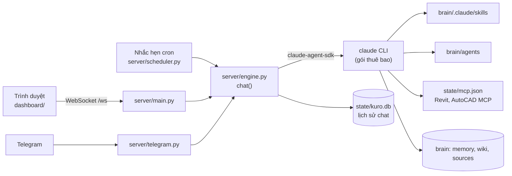

# Kuro OS - Kế hoạch và mã nguồn

> Trợ lý AI tự host kiểu Javis OS, dành cho kỹ sư hạ tầng: chat trên web và Telegram, nhớ ký ức, dùng skill
> và agent ngành, nhắc hẹn theo lịch, kết nối Revit/AutoCAD qua MCP. Tên "Kuro OS" là tạm, đổi tuỳ ý.
> Cập nhật 2026-10-31. Tham khảo kiến trúc Javis OS 0.86.2 (`E:\0.Code\1.JavisOS\ARCHITECTURE.md`).

**Trạng thái: bản đầu đã viết xong và chạy thử thật** (mục 9), có **lớp tính toán kỹ thuật chính xác**
(mục 1b). Muốn dùng ngay: đọc mục 3.

---

## 1. Phân tích: vì sao chỉ ~590 dòng mà Javis cần hơn 21.000

Javis tự viết lại mọi thứ để chạy được với 11 bộ não khác nhau. Kuro bắt đầu với **một** bộ não (Claude
Code qua `claude-agent-sdk`) nên dùng lại luôn những gì SDK đã làm sẵn:

| Việc | Javis tự viết | Kuro dùng sẵn của SDK |
|---|---|---|
| Liệt kê và nạp skill | `skill_router.py`, ngân sách ký tự, ghim | `skills="all"`: Claude Code tự liệt kê và nạp |
| Agent chuyên trách | `agent_runtime.py` | `agents=`: đọc `agents/*.md` thành subagent |
| Kết nối MCP (Revit, AutoCAD...) | `mcp_hub.py`, `mcp_client.py` | `mcp_servers=state/mcp.json` |
| Chặn quyền tool | Hub kiểm 3 mức quyền | `tools=` + `allowed_tools` + `permission_mode="dontAsk"` |
| Nhớ cuộc trò chuyện | Gửi lại lịch sử, nén phiên dài | `resume=<session_id>` |
| Tự ghi ký ức | `learn.py` chạy nền | Luật trong `CLAUDE.md` của brain, Claude tự ghi bằng tool Write |

**Cái giá:** chỉ chạy được với Claude. Muốn thêm ChatGPT hay Gemini thì phải viết adapter và một MCP Hub
riêng (giai đoạn P8, mục 7). Với một người dùng có gói Claude thì đây là đánh đổi đáng.

**Fork Javis hay dùng Kuro?** Javis (giấy phép MIT) có đủ mọi thứ nhưng code lớn, khó sửa. Kuro nhỏ, hiểu
được từng dòng, dễ thêm nghiệp vụ ngành. Chép nguyên đoạn code nào của Javis thì giữ dòng
`Copyright (c) 2026 Nguyễn Minh Quý` (điều kiện duy nhất của MIT).

---

## 1b. Lớp tính toán kỹ thuật chính xác

Nguồn sai lớn nhất khi dùng AI cho kỹ thuật là **model tự nhẩm số** và **tự nhớ hệ số**. Kuro chặn cả hai:

| Lớp | Làm gì | Ở đâu |
|---|---|---|
| Tool `tinh_python` | Mọi con số được tính bằng Python thật trong tiến trình riêng, tối đa 120 giây. **Mỗi lần tính lưu lại script** vào `brain/tinh-toan/` để soát | `server/calc.py` |
| Thư viện kỹ thuật đã duyệt | Đơn vị, tiết diện, BTCT, phân tích khung, IFC, DXF, Excel, Word, PDF. Phiên bản được ghim cố định | `requirements-ky-thuat.txt` |
| Skill `tinh-toan-ky-thuat` | Quy trình bắt buộc: đầu vào có nguồn, đơn vị rõ, **kiểm tra chéo bằng cách thứ hai**, lệch quá 2% thì dừng, chỉ kết luận ĐẠT khi đủ dữ liệu | `skills/` (tự cài vào mọi brain mới) |
| Luật trong prompt gốc | "Không tự nhẩm", cường độ lấy từ trí nhớ phải ghi "(cần xác minh)" | `CLAUDE.md` |
| Bài kiểm tra chống "skill dạy sai" | Chạy lại mọi code mẫu trong skill, so với đáp số tính tay. Cập nhật thư viện mà lệch là báo ngay | `tests/test_core.py` |

Thư viện đã soát (giấy phép, độ mới, bản cài cho Python 3.13):

| Thư viện | Dùng cho | Giấy phép | Kiểm chứng |
|---|---|---|---|
| `pint` 0.26.2 | Đơn vị đo, chống trộn kN với N, m với mm | BSD-3 | 20,25 kNm khớp tay |
| `sectionproperties` 3.10.2 | Đặc trưng tiết diện bất kỳ (A, I, W, tâm cắt...) | MIT | A, I của 300×600 khớp tay |
| `concreteproperties` 0.8.0 | Tiết diện BTCT: khả năng chịu uốn, biểu đồ tương tác, mô men - độ cong | MIT | Mu dầm 3Ø20 = 168,9 kNm, lệch 0,00% |
| `PyNiteFEA` 3.2.1 | Phân tích khung 3D, tổ hợp tải, tự kiểm cân bằng tĩnh | MIT | M = 45,00 kNm, võng 1,042 mm khớp tay |
| `numpy`, `scipy`, `pandas`, `shapely`, `matplotlib` | Tính số, giải phương trình, bảng, hình học, biểu đồ | BSD / PSF | |
| `ezdxf`, `openpyxl`, `python-docx`, `pdfplumber`, `ifcopenshell` | DXF, Excel, Word, đọc bảng trong PDF tiêu chuẩn, mô hình IFC | MIT / LGPL-3 | Cài thành công |

Không cài: `anastruct` (GPL-3.0: đem phát cho nhiều người thì ràng buộc mã nguồn của bạn; PyNite đã thay
được), `openseespy` (giấy phép riêng, chưa rõ có được dùng thương mại không).

**Giới hạn cần biết:** các thư viện không có sẵn TCVN. Chúng giải đúng phần cơ học; còn cường độ vật liệu,
hệ số, khối ứng suất quy đổi, ξR, hàm lượng thép phải đặt theo tiêu chuẩn **kèm nguồn**. Muốn hết "(cần
xác minh)" thì đưa bản PDF TCVN của bạn vào `brains/<brain>/sources/` để Kuro tra đúng bảng.

---

## 2. Kiến trúc



Ba nguyên tắc:

1. **Một hàm `engine.chat()` cho mọi đường vào** (web, Telegram, nhắc hẹn). Thêm kênh mới là gọi hàm
   này, không chép lại logic.
2. **Quyền được chặn bằng code**, không tin vào prompt: tool không có trong `KURO_ALLOWED_TOOLS` thì
   không tồn tại đối với Claude.
3. **Ba nơi dữ liệu tách bạch**: code (thư mục này), `state/` (lịch sử, cấu hình máy, không commit),
   `brains/` (ký ức và tri thức của bạn, có thể đẩy lên GitHub riêng).

---

## 3. Cài và chạy (lần đầu khoảng 5 phút)

Cần có sẵn: Python 3.12 hoặc 3.13, Node.js, Claude Code (`npm install -g @anthropic-ai/claude-code`) đã
đăng nhập (`claude auth login`). Máy này đã có đủ.

| Bước | Làm gì | Kết quả |
|---|---|---|
| 1 | Bấm đúp `setup.bat` | Tạo `.venv`, cài thư viện, tạo `.env` từ `env.example` |
| 2 | Bấm đúp `nhap-tu-javis.bat` | Chép ký ức, skill, wiki, agent từ brain Javis sang (chạy lại lúc nào cũng được) |
| 3 | Bấm đúp `run.bat` | Server chạy ở **http://127.0.0.1:7788** và trình duyệt tự mở |

Kuro dùng cổng **7788** để chạy song song với Javis (7777). Tắt Kuro: đóng cửa sổ đen của `run.bat`.

Chạy kiểm tra:

```bash
.venv/Scripts/python -m unittest discover -s tests
```

---

## 4. Cấu trúc thư mục

```text
2.KuroOS/
  KE-HOACH.md            tài liệu này
  CLAUDE.md              prompt gốc: vai trò, luật số liệu, cách làm việc (mọi lượt chat đều nhận)
  env.example            mẫu cấu hình; setup.bat chép thành .env
  requirements.txt       fastapi, uvicorn, claude-agent-sdk, httpx, python-dotenv, pyyaml
  requirements-ky-thuat.txt   thư viện tính toán kỹ thuật, phiên bản ghim
  skills/tinh-toan-ky-thuat/  skill mặc định, tự chép vào mọi brain mới
  setup.bat  run.bat  nhap-tu-javis.bat
  server/
    config.py      (55)  đọc .env, tạo khung brain lần đầu, cài skill mặc định
    store.py       (60)  SQLite: phiên chat và tin nhắn
    engine.py     (123)  chạy một lượt qua claude-agent-sdk, nạp agent và MCP, hàm chat() dùng chung
    calc.py        (52)  tool tinh_python: chạy Python tính toán, lưu script để soát
    scheduler.py   (74)  cron 5 trường + vòng lặp 30 giây đọc state/reminders.json
    telegram.py    (45)  long-poll, chỉ trả lời ID chủ, lệnh /moi
    main.py        (66)  FastAPI: /ws, /api/sessions, /health, phục vụ dashboard
  dashboard/
    index.html  app.js   danh sách phiên, chat stream, markdown, chip tool, sáng/tối theo máy
  examples/
    mcp.json  reminders.json   mẫu, chép vào state/ rồi sửa
  tests/
    test_core.py         cron, lưu phiên, đọc agent, tool tính, code mẫu của skill khớp tính tay
  state/                 (tự tạo, không commit) .env trỏ tới; kuro.db, mcp.json, reminders.json
  brains/Brain Default/  (tự tạo, không commit)
    CLAUDE.md            luật của brain: cách ghi ký ức
    memory/MEMORY.md     mục lục ký ức, nạp vào mọi lượt chat
    memory/facts/        mỗi ký ức một file
    .claude/skills/      skill (cùng định dạng Javis)
    agents/              agent (cùng định dạng Javis)
    sources/  wiki/      tài liệu gốc và tri thức đã chưng cất
    tinh-toan/           script của mọi lần tính (tự sinh)
```

---

## 5. Cấu hình

### 5.1 `.env`

| Biến | Mặc định | Ý nghĩa |
|---|---|---|
| `KURO_STATE_DIR` | `state` | Nơi lưu lịch sử chat, mcp.json, reminders.json |
| `KURO_BRAINS_DIR`, `KURO_BRAIN` | `brains`, `Brain Default` | Brain đang dùng; đổi tên để có nhiều brain (mỗi dự án một brain) |
| `KURO_HOST`, `KURO_PORT` | `127.0.0.1`, `7788` | **Giữ 127.0.0.1** chừng nào chưa có đăng nhập (mục 7) |
| `KURO_PROVIDER`, `KURO_AI_KEY`, `KURO_BASE_URL` | trống | AI chạy Kuro (`config.PROVIDERS`). Mọi hãng đều chạy qua Claude Code; hãng khác Claude được trỏ tới bằng `ANTHROPIC_BASE_URL` (cổng tương thích Anthropic), nên skill, agent và tool đều giữ nguyên. Trống = lần đầu mở hiện màn hình chọn AI |
| `KURO_MODEL` | trống | Trống = model mặc định của gói; hoặc `sonnet`, `opus`, `haiku` |
| `KURO_ALLOWED_TOOLS` | `Read,Glob,Grep,Write,Edit,WebSearch,WebFetch,mcp__kuro__tinh_python` | Tool Claude được dùng. Bỏ `mcp__kuro__tinh_python` là tắt tool tính. Thêm `Bash` để chạy script Python của skill; thêm `mcp__revit-mcp` để mở một MCP |
| `TELEGRAM_BOT_TOKEN`, `TELEGRAM_OWNER_IDS` | trống | Bật Telegram. Token lấy ở @BotFather, ID của bạn ở @userinfobot |

`Skill` và `Agent` luôn được bật trong code, không cần ghi vào danh sách.

Nút **⚙ Cài đặt** trên giao diện sửa được 5 khóa: API key, model, tool, token và ID Telegram. Key chỉ hiện 4 ký tự cuối. Model, tool và API key có hiệu lực từ câu hỏi kế tiếp, Telegram cần khởi động lại. Các route `/api/settings` và `/ws` chỉ nhận yêu cầu từ chính trang Kuro: kiểm `Host` và `Origin` để chặn CSRF và DNS rebinding.

### 5.2 Kết nối Revit/AutoCAD qua MCP: `state/mcp.json`

Chép `examples/mcp.json` vào `state/`, sửa đường dẫn server MCP, rồi thêm `mcp__<ten>` vào
`KURO_ALLOWED_TOOLS`. Định dạng giống hệt `.mcp.json` của Claude Code:

```json
{ "mcpServers": { "revit-mcp": { "command": "node", "args": ["C:/.../revit-mcp/build/index.js"] } } }
```

### 5.3 Nhắc hẹn: `state/reminders.json`

```json
[{ "id": "tien-do-tuan", "cron": "0 7 * * 1", "prompt": "Tổng hợp tiến độ tuần...", "enabled": true }]
```

Cron 5 trường: `phút giờ ngày tháng thứ` (0 hoặc 7 = Chủ nhật). Hỗ trợ `*`, `*/15`, `8-17`, `1,15`. Kết quả
lưu vào phiên `nhac-<id>` trên giao diện, và gửi Telegram nếu đã bật. Sửa file là có hiệu lực ở vòng 30 giây
kế tiếp, không cần khởi động lại.

### 5.4 Thêm skill, agent, ký ức

| Loại | Đặt ở | Ghi chú |
|---|---|---|
| Skill | `brains/<brain>/.claude/skills/<slug>/SKILL.md` | Frontmatter `name`, `description` |
| Agent | `brains/<brain>/agents/<slug>.md` | Frontmatter `slug`, `role` (thành mô tả), `skills: [...]`, `model`; thân bài là prompt |
| Ký ức | `brains/<brain>/memory/facts/<slug>.md` + 1 dòng trong `MEMORY.md` | Kuro tự ghi khi gặp thông tin bền vững |

Thêm hay sửa skill, agent có hiệu lực ngay ở lượt chat kế tiếp.

---

## 6. Đọc code theo thứ tự này

1. **`server/engine.py`**: trái tim. `options()` là toàn bộ cấu hình gửi cho Claude: prompt ghép từ
   `CLAUDE.md` gốc, ký ức và giờ hiện tại; cùng skill, agent, MCP và quyền. `run_turn()` đổi luồng tin
   nhắn của SDK thành sự kiện `text / tool / final / error`. `chat()` lưu câu hỏi, chạy, lưu câu trả lời
   và nhớ `claude_id` để lượt sau nối tiếp.
2. **`server/main.py`**: WebSocket nhận `{"session", "text"}`, gọi `engine.chat(..., emit=sock.send_json)`.
3. **`dashboard/app.js`**: gửi tin, ghép các đoạn `text` rồi render markdown (đã lọc bằng DOMPurify).
4. **`server/scheduler.py`** và **`server/telegram.py`**: hai đường vào khác, cùng gọi `engine.chat()`.

---

## 7. Lộ trình tiếp theo

| GĐ | Việc | Cách làm gọn nhất | Trạng thái |
|---|---|---|---|
| P1 | Chat stream trên web | `main.py` + `engine.py` + `dashboard/` | **Xong** |
| P2 | Ký ức, lịch sử, nhớ phiên | `MEMORY.md` vào prompt, SQLite, `resume=` | **Xong** |
| P3 | Skill ngành | `skills="all"`, skill ở `.claude/skills` | **Xong** |
| P4 | Agent kỹ sư | `agents=load_agents()` | **Xong** |
| P5 | MCP + chặn quyền | `mcp_servers=`, `tools=`, `dontAsk` | **Xong** (chưa nối MCP thật, chỉ có file mẫu) |
| P6 | Nhắc hẹn, Telegram | `scheduler.py`, `telegram.py` | **Xong** (Telegram chưa chạy thử vì chưa có token) |
| P7 | **Đăng nhập** (bắt buộc trước khi mở ra mạng hay lên VPS) | Một mật khẩu trong `.env` (băm PBKDF2), cookie phiên, kiểm ở `/ws` và `/api/*`. Tham khảo `web_security.py` của Javis | Chưa |
| P8 | Thêm bộ não khác (ChatGPT, Gemini) | Adapter API kiểu OpenAI qua OpenRouter, trả cùng sự kiện như `run_turn()`. Phải tự làm tool đọc/ghi brain và MCP Hub, vì chỉ Claude Code có sẵn. Tham khảo `engine.py`, `mcp_hub.py` của Javis | Chưa |
| P9 | Hàng đợi việc nền (Kanban), hộp thư kết quả | Bảng `tasks` trong `kuro.db`, worker `asyncio` gọi `engine.chat()` | Chưa |
| P10 | Giọng nói, đóng gói | Web Speech API trên trình duyệt (không cần server); `edge-tts` để đọc; icon Desktop như đã làm cho Javis | Chưa |

Gợi ý thứ tự: **P7 trước** nếu định dùng ngoài máy này; nếu chỉ dùng tại máy thì làm P9 trước.

---

## 8. Bảo mật

- [x] Chỉ nghe `127.0.0.1` mặc định.
- [x] Không đọc token đăng nhập của Claude; SDK gọi chính `claude` CLI.
- [x] Quyền tool chặn bằng code (`tools=` + `dontAsk`); `Bash` tắt mặc định (đã thử: bị chặn thật).
- [ ] `tinh_python` **chạy được code Python** (giới hạn 120 giây, nhưng không cách ly mạng hay ổ đĩa). An toàn khi
      chỉ mình bạn dùng ở `127.0.0.1`. Trước khi cho người khác dùng: làm P7 đăng nhập, và cân nhắc tắt `WebFetch`
      để trang web lạ không thể dụ Kuro chạy code.
- [x] Kuro chỉ đọc cấu hình trong brain (`setting_sources=["project"]`), **không** nạp hook, plugin và
      `CLAUDE.md` cá nhân trong `~/.claude` của máy.
- [x] Câu trả lời render qua DOMPurify, nên chữ của model không chạy được mã trên trang.
- [x] Telegram chỉ trả lời ID trong `TELEGRAM_OWNER_IDS`.
- [x] `.env`, `state/`, `brains/` nằm trong `.gitignore`.
- [ ] Đăng nhập web (P7) trước khi đổi `KURO_HOST` khỏi `127.0.0.1`.
- [ ] Skill hay MCP lấy từ GitHub: duyệt trước như đã làm ở `E:\0.Code\skills-da-duyet\`.

---

## 9. Đã kiểm thử thật (2026-10-31)

| Phép thử | Kết quả |
|---|---|
| 10 bài kiểm tra tự động (cron, lưu phiên, đọc agent, tool tính, 4 code mẫu của skill khớp tính tay) | Đạt 10/10 |
| Câu hỏi thật: dầm 300×600 nhịp 6 m, q = 30 kN/m, 3Ø20 | Tự nạp skill, tính bằng tool: M = 135,0 kNm, Mu = 168,9 kNm (2 cách lệch 0,00%), ξ = 0,138 < ξR = 0,533; tự ghi "(cần xác minh)" cho cường độ và nói rõ chưa kiểm cắt, võng, nứt |
| Chat qua WebSocket, chữ stream về | Đạt |
| Lượt 2 nhớ con số đưa ở lượt 1 (`resume`) | Đạt |
| Tự ghi ký ức vào `memory/facts/` khi được nhờ nhớ | Đạt |
| Gọi skill `kiem-toan-ket-cau-phu-tro` | Đạt |
| Giao việc cho agent `ky-su-qs` | Đạt |
| Yêu cầu chạy `echo` bằng Bash khi Bash không được phép | Bị chặn đúng |
| Nhắc hẹn chạy đúng giờ, Telegram | **Chưa thử thật** (logic cron đã có bài kiểm tra; Telegram cần token) |

Dữ liệu chat thử đã được xoá; brain hiện chứa đúng ký ức, skill, wiki và agent chép từ Javis.

---

## 10. Bẫy đã gặp thật (để khỏi mất thời gian lần sau)

| Bẫy | Hậu quả | Đã xử lý |
|---|---|---|
| `permission_mode="dontAsk"` một mình **vẫn cho chạy** lệnh Bash "chỉ đọc" như `echo` | Lọt tool không được phép | Thêm `tools=` để gỡ hẳn tool khỏi phiên |
| Bật `skills=` mà không đặt `setting_sources` | SDK nạp luôn hook, plugin, CLAUDE.md cá nhân của máy | `setting_sources=["project"]` |
| Claude trả lời bằng kiến thức chung, không mở skill | Bỏ qua quy trình ngành | Luật trong `CLAUDE.md` gốc: nạp skill trước khi trả lời câu chuyên môn |
| Trùng cổng với Javis (7777) | Server không lên | Kuro dùng 7788 |
| Gọi file `.bat` bằng tên trần từ terminal | `not recognized` | Gọi bằng đường dẫn đầy đủ; bấm đúp thì không sao |
| File Windows có `\r\n` | YAML và regex đọc sai | Chuẩn hoá `\r\n` thành `\n` khi đọc |
| Skill riêng của Javis (`javis-builder`, `html-to-webcake`) | Chỉ dẫn sai trong Kuro | Script nhập loại hai skill này |
| Python 3.14 trên máy thiếu pip và thư viện | Script hỏng | Dùng `.venv` Python 3.13 |
| Ghi file `.bat` bằng lệnh Git Bash | Công cụ tự đổi `>nul` thành `>/dev/null`, cmd báo "The system cannot find the path specified" | Sửa `.bat` bằng công cụ Edit/Write; trong `.bat` dùng `where /q` thay vì chuyển hướng vào `nul` |
| agy (Antigravity) bị từ chối ghi file khi chạy nền | Dừng lượt, `status` vẫn SUCCESS, `response` rỗng, lý do chỉ có ở stderr: bong bóng trả lời trống | `cli_engines` đọc `denied_actions` và luôn báo lý do; khi chưa bật Bash, lời dặn bảo AI không ghi file và không chạy lệnh |
| Sandbox của codex trên Windows | `elevated` lỗi quyền (mã 5) trên máy thường; `unelevated` chạy được nhưng KHÔNG chặn ghi ra ngoài thư mục (đã thử) | Không coi sandbox codex là lớp bảo vệ: chỉ cho chạy lệnh khi bật Bash; luôn `--ignore-user-config` để không nạp MCP cá nhân |
| `pip install -q` trong `setup.bat` | Máy mới thấy màn hình đen 5-15 phút, tưởng treo | In từng bước `[1/4]...` và để pip hiện tiến độ |
| Danh sách skill quá dài (49 skill, có 21 skill lập trình) | Claude chọn skill kém chính xác hơn | Xoá bớt skill không dùng trong `.claude/skills` |
