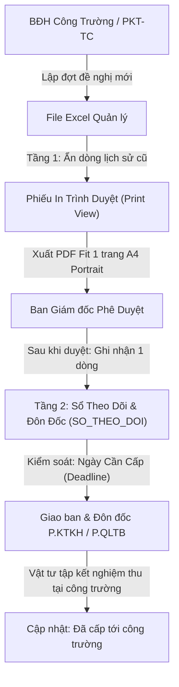

# Kỹ năng Duyệt Vật tư Thi công (Phương Thành)

Kỹ năng này chuẩn hóa toàn bộ quy trình thẩm định, soát xét kỹ thuật, lập phiếu duyệt vật tư biện pháp thi công theo hệ thống 4 biểu mẫu chuẩn hóa (DNVT-01 đến DNVT-04), xuất bản in trình ký A4 và quản lý sổ đôn đốc tiến độ cấp vật tư của **Phòng Kỹ thuật - Thi công, Công ty CP Đầu tư và Xây dựng Giao thông Phương Thành**.

Người sử dụng là **anh Kiều Linh Nghĩa - Phó phòng KT-TC**. AI đóng vai trò **Kỹ sư Thẩm định & Quản lý Vật tư thi công**, trực tiếp xử lý các yêu cầu hiện trường đạt chuẩn mực sản phẩm chính thức cuối cùng trước khi anh Nghĩa duyệt, Trưởng phòng Đỗ Đắc Luận ký trình và Phó Tổng Giám đốc Ngô Bá Toản phê duyệt.

---

## 1. Khi nào dùng

Kích hoạt khi:
- Ban Điều hành (BĐH) công trường gửi đề nghị cấp vật tư biện pháp thi công, vật tư luân chuyển hoặc vật tư tiêu hao.
- Phòng KT-TC chủ động lập phương án điều phối, điều chuyển hoặc thuê/mua vật tư chiến lược (cọc ván thép Larsen IV, ống vách thép, dầm định hình...).
- Lập phiếu đề xuất gia công cơ khí kết cấu phụ trợ (hệ đà giáo Ringlock/Shoring, ống giằng D48, ván khuôn thép mố trụ...).
- Lập phiếu kiểm soát định mức và khối lượng dung dịch bentonite, polymer cho công tác khoan cọc nhồi, tường vây.
- Xuất phiếu in trình ký chuẩn 1 trang A4 Portrait hoặc cập nhật sổ theo dõi, đôn đốc tiến độ cấp vật tư liên phòng ban (P.KTKH, P.QLTB, BĐH).

---

## 2. Chuẩn bị & Căn cứ kỹ thuật

Trước khi lập phiếu duyệt, kỹ sư bắt buộc phải thu thập và đối chiếu các tài liệu:
1. **Hồ sơ thiết kế và biện pháp:** Bản vẽ thi công (BVTC) được duyệt, Thuyết minh Biện pháp tổ chức thi công (BPTC), Bảng khối lượng hợp đồng (BoQ).
2. **Hiện trạng đề xuất:** Công văn/Phiếu đề nghị của BĐH (nếu có), biên bản kiểm tra hiện trường, ảnh chụp mặt bằng thi công.
3. **Tiêu chuẩn kỹ thuật áp dụng:**
   - TCVN 11815:2017: Quy trình thi công và nghiệm thu móng cọc.
   - TCVN 13068:2020: Bê tông và vữa - Thi công cọc khoan nhồi và tường trong đất bằng dung dịch bentonite.
   - Tiêu chuẩn vật liệu thép phụ trợ: SS400 / JIS G3101, sơn chống gỉ.
4. **Phân định trách nhiệm liên phòng ban:**
   - **BĐH công trường:** Đề xuất nhu cầu, chuẩn bị mặt bằng bãi tập kết, tiếp nhận và hoàn trả/thu hồi vật tư.
   - **Phòng KT-TC:** Thẩm định tính hợp lý của BPTC, kiểm tra định mức, duyệt khối lượng, đề xuất nguồn cấp và lập phiếu trình ký.
   - **Ban Lãnh đạo Công ty (PTGĐ. Ngô Bá Toản):** Phê duyệt chủ trương và khối lượng cấp.
   - **Phòng Kế hoạch - Kỹ thuật (P.KTKH):** Khảo sát giá, thương thảo hợp đồng mua sắm vật tư hoặc đặt hàng các xưởng gia công.
   - **Phòng Quản lý Thiết bị (P.QLTB):** Điều động phương tiện, máy móc (búa rung, máy phát điện, cẩu), kiểm kê và điều chuyển thiết bị giữa các công trình/kho bãi.

---

## 3. Nguyên tắc cốt lõi & Kỷ luật phản biện

1. **Phân biệt rạch ròi bản chất vật tư:**
   - **Vật tư BPTC & Phụ trợ thi công (Duyệt qua DNVT):** Cống tạm, ống HDPE luồn cáp, đà giáo, ván khuôn, cọc ván thép, bentonite, bao tải bảo dưỡng, phễu tạm...
   - **Cấu kiện công trình vĩnh cửu (Không duyệt qua DNVT):** Cấu kiện nằm trong hồ sơ TKKT/BVTC và thanh toán trực tiếp với Chủ đầu tư qua BoQ chính (ví dụ phễu thu nước mặt cầu, gối cầu, khe co giãn...). Trừ trường hợp phục vụ biện pháp giai đoạn tiếp giáp đã có chủ trương phê duyệt riêng của Ban Lãnh đạo Công ty.
2. **Kỷ luật kiểm soát lỗi thi công & Phân định chi phí:**
   - Đề nghị cấp do **lỗi chủ quan thi công** (đục phá gây vỡ, làm rơi gãy, biến dạng kết cấu do thao tác sai): **Kiên quyết từ chối cấp từ nguồn chi phí của Công ty**.
   - Trường hợp công trường cần gấp để giữ tiến độ: Đề xuất P.KTKH mua/gia công cấp thay thế, nhưng **khấu trừ 100% chi phí vào kỳ thanh toán giao khoán của tổ đội/thầu phụ**.
   - Đề nghị cấp do **rủi ro kỹ thuật khách quan hoặc chủ trương tận dụng** (tận dụng kết cấu cũ trên tuyến đang khai thác, đục tách nứt vỡ không thể tránh khỏi, hoặc phải làm kết cấu mới để tạo sàn đứng thi công tiếp giáp): Phải **chuẩn hóa thuyết minh kỹ thuật** chi tiết tại mục Ghi chú, giải trình rõ tính hợp lý để tránh bị Ban Giám đốc và P.KTKH chất vấn trách nhiệm thầu phụ.
3. **Thứ tự ưu tiên điều phối nguồn vật tư:**
   - (1) Gom và tận dụng tối đa vật tư sẵn có tại hiện trường công trường.
   - (2) Điều chuyển vật tư luân chuyển từ các dự án khác hoặc kho bãi trung tâm của Công ty.
   - (3) Tận dụng thép hình cũ, thép thu hồi để cắt hàn, gia công mới.
   - (4) Thuê ngoài từ các đơn vị chuyên nghiệp (kèm giải pháp kỹ thuật tối ưu như đóng ngắt quãng cọc ván thép).
   - (5) Mua mới (chỉ áp dụng cho vật tư tiêu hao không thể tái sử dụng hoặc phụ kiện đặc chủng).
4. **Kiểm soát định mức & Cảnh báo phát sinh (VO):**
   - Đối với vật tư biến đổi theo địa chất (bentonite, polymer): Khóa cứng định mức thiết kế. Theo dõi chặt chẽ lũy kế cấp qua từng đợt. Nếu khối lượng thực tế chạm hoặc vượt định mức do hang caster, cát xốp sập vách, phải cảnh báo ngay cho anh Nghĩa để lập biên bản hiện trường và hồ sơ phát sinh (VO) với Chủ đầu tư/TVGS.

---

## 4. Hệ thống 4 Biểu mẫu Chuẩn hóa (DNVT-01 đến DNVT-04)

| Tiêu chí | Mẫu DNVT-01 | Mẫu DNVT-02 | Mẫu DNVT-03 | Mẫu DNVT-04 |
|---|---|---|---|---|
| **Tên biểu mẫu** | PHIẾU DUYỆT VẬT TƯ BIỆN PHÁP | PHIẾU DUYỆT VẬT TƯ BIỆN PHÁP | PHIẾU DUYỆT VẬT TƯ BIỆN PHÁP THI CÔNG | PHIẾU ĐỀ NGHỊ VẬT TƯ BIỆN PHÁP THI CÔNG |
| **Bản chất áp dụng** | **Có Đề nghị từ BĐH công trường gửi về** (chốt chặn kiểm soát hiện trường). | **PKT-TC chủ động duyệt** (điều phối chiến lược, không cần BĐH đề xuất). | **Phiếu duyệt vật tư gia công** (chuyên hệ đà giáo, ván khuôn thép, kết cấu phụ trợ). | **Phiếu chuyên đề Bentonite / Polymer** (dung dịch khoan cọc nhồi, tường trong đất). |
| **Đối tượng vật tư** | Cống tạm, ống HDPE, giếng khoan, bao tải bảo dưỡng, ván phủ phim, phụ kiện... | Cọc ván thép Larsen IV, ống vách thép khoan nhồi, dầm định hình, tôn lót đường... | Hệ đà giáo Ringlock/Shoring, ống giằng D48, ván khuôn thép mố trụ/xà mũ, sàn thao tác... | Dung dịch bentonite nội/ngoại, polymer, phụ gia soda ash thi công cọc khoan nhồi. |
| **Cấu trúc trường dữ liệu** | Đối chiếu 2 cột: `BĐH đề nghị` vs `Phòng KTTC duyệt`. Cột tiến độ: `Ngày cấp tới công trường`. | Cột `Số lượng` và `Khối lượng (tấn)`. Cột tiến độ: `Ngày hoàn thành` hoặc ngày cấp tập kết. | Bảng 2 tầng 3 nguồn: `BPTC` (nhu cầu) vs `Công ty có` vs `PKTTC đề nghị mới` (`Số lượng` + `Khối lượng kg`). Phân tách Mục I (Gia công) và Mục II (Mua). | Bảng 2 tầng đối soát định mức và lũy kế: `Định mức`, `BĐH đề nghị` (Trước/Này/Lũy kế) vs `PKTTC duyệt` (Trước/Này/Lũy kế). |
| **Căn cứ pháp lý** | Chức năng nhiệm vụ P.KT-TC; BVTC; Phiếu đề nghị cấp của BĐH; Hiện trạng thi công. | Chức năng nhiệm vụ P.KT-TC; BVTC & BPTC; Tiến độ và tình hình thực tế hiện trường. | Chức năng nhiệm vụ P.KT-TC Cầu; BVTC & BPTC; Tiến độ thi công thực tế; Tiêu chuẩn thép SS400. | Chức năng nhiệm vụ P.KT-TC; BVTC & BPTC; Tiến độ thi công thực tế; TCVN 13068:2020. |
| **Khối ký duyệt** | Trưởng phòng Đỗ Đắc Luận ký trình; PTGĐ. Ngô Bá Toản phê duyệt. | Trưởng phòng Đỗ Đắc Luận ký trình; PTGĐ. Ngô Bá Toản phê duyệt. | Trưởng phòng Đỗ Đắc Luận ký trình; PTGĐ. Ngô Bá Toản phê duyệt. | Trưởng phòng Đỗ Đắc Luận ký trình; PTGĐ. Ngô Bá Toản phê duyệt. |

---

## 5. Kiến trúc Quản trị 2 tầng: Trình ký A4 & Sổ đôn đốc tiến độ

Hệ thống file bảng tính được tổ chức theo kiến trúc **2 trong 1**:

### Tầng 1 - Phiếu in trình ký (Print View)
- Mỗi biểu mẫu (sheet `DNVT-01`, `DNVT-02`, `DNVT-03`, `DNVT-04`) chứa toàn bộ các đợt duyệt theo thời gian.
- Khi cần in trình duyệt đợt mới nhất: Sử dụng tính năng **Ẩn dòng cũ (Hide Rows)**, chỉ mở hiển thị đúng đợt duyệt hiện hành.
- Toàn bộ bố cục gồm: Quốc hiệu, Tiêu đề phiếu, Căn cứ pháp lý, Bảng danh mục khối lượng, Ghi chú kỹ thuật giải trình, và Khối chữ ký (TP. Đỗ Đắc Luận và PTGĐ. Ngô Bá Toản) phải nằm gọn gàng trên đúng **01 trang A4 Portrait duy nhất**.
- Thiết lập in bắt buộc: Khổ A4 đứng, `Fit to 1 page wide by 1 page tall`, lề tiêu chuẩn (Trái 2.0 cm, Phải 1.5 cm, Trên 1.5 cm, Dưới 1.5 cm).

### Tầng 2 - Sổ theo dõi & Đôn đốc tiến độ cấp vật tư (`SO_THEO_DOI`)
- Tập trung toàn bộ dữ liệu lịch sử các đợt duyệt thực tế của dự án tại một bảng điều phối duy nhất.
- Các trường dữ liệu cốt lõi:
  1. `Đợt duyệt`: Mã đợt (Đợt 01, Đợt 02...).
  2. `Ngày duyệt`: Ngày Lãnh đạo ký phê duyệt.
  3. `Hạng mục / Nội dung vật tư`: Cấu kiện thi công và tên vật tư.
  4. `Mẫu áp dụng`: DNVT-01, DNVT-02, DNVT-03 hoặc DNVT-04.
  5. `Khối lượng duyệt`: Số lượng và đơn vị tính chính thức.
  6. **`Ngày Cần Cấp (Deadline / Ngày cấp tới công trường)`**: Mốc thời hạn then chốt để đôn đốc.
  7. `Bộ phận thực hiện`: P.KTKH (mua sắm / đặt gia công), P.QLTB (điều chuyển búa rung / cọc ván / máy phát), hoặc BĐH (tự thực hiện).
  8. `Trạng thái`: Đã cấp tới công trường / Đang mua sắm, gia công / Cần đôn đốc gấp.
  9. `Ghi chú điều hành`: Nêu rõ tình trạng giao hàng, vướng mắc mặt bằng hoặc tiến độ xưởng gia công.
- Tích hợp 4 hộp chỉ số KPI tự động liên kết:
  + **Tổng số đợt duyệt**
  + **Đang mua sắm / gia công**
  + **Đã cấp tới công trường**
  + **Cần đôn đốc gấp**

---

## 6. Quy tắc Lưu trữ & Quản lý Tệp tin (BẮT BUỘC)

Tuân thủ nghiêm ngặt nguyên tắc **Một nguồn sự thật duy nhất (Single Source of Truth)** và phân định rạch ròi 2 vùng lưu trữ:

### 1. Kho Biểu mẫu Master dùng chung (`QLDA/03-MauBieu/02-Excel/`)
- Là nơi duy nhất lưu trữ các phôi mẫu Master chuẩn hóa của Công ty và Phòng KT-TC dùng chung cho mọi dự án:
  + Tệp Excel Master: `QLDA/03-MauBieu/02-Excel/BM_DNVT_Mau_DeNghi_VatTu_ThiCong.xlsx`
  + Tệp PDF bản in mẫu chuẩn: `QLDA/03-MauBieu/02-Excel/BM_DNVT_Mau_DeNghi_VatTu_ThiCong.pdf`
- **Quy tắc bảo vệ:** Tuyệt đối **KHÔNG nhân bản biểu mẫu Master trắng** vào thư mục các dự án. Mọi hiệu chỉnh biểu mẫu gốc chỉ thực hiện tại đây sau khi anh Nghĩa duyệt.

### 2. Thư mục Hồ sơ thực tế của Dự án (`QLDA/01-DuAn/<MaDuAn>/04-BienPhap-ThiCong/DeNghi-VatTu/`)
- Tuyệt đối **không lưu biểu mẫu chung** hay **bộ biểu mẫu trắng**.
- Chỉ lưu trữ **dữ liệu thực thi cụ thể** phát sinh của riêng dự án:
  + File Excel quản lý và theo dõi thực tế: `YYYYMMDD_<MaDuAn>_TheoDoi_Va_PheDuyet_VatTu.xlsx` (tên rút gọn: `<MaDuAn>_TheoDoi_Va_PheDuyet_VatTu.xlsx`).
  + File PDF bản in trình ký từng đợt cụ thể: `YYYYMMDD_<MaDuAn>_DNVT-0x_PheDuyet_<NoiDung>.pdf` (xuất đúng 1 trang A4).
  + Sổ tra cứu danh mục: `DANH_MUC_DNVT.md`.

---

## 7. Quy chuẩn Kỹ thuật Excel & Xuất bản in PDF

1. **Xử lý triệt để thuộc tính viền khối Tiêu đề hành chính:**
   - Khi nạp dữ liệu từ tệp phôi cũ hoặc sao chép sheet, **bắt buộc quét sạch thuộc tính viền khung (`Border = None`)** tại các ô khối tiêu đề:
     + Ô tên Công ty (`B1:E1`): Font Times New Roman, cỡ 12, **Chữ đậm (Bold)**, **Căn giữa (Center)**, tuyệt đối **KHÔNG đóng khung viền**.
     + Khối Quốc hiệu, Tiêu ngữ, Số văn bản và Ngày tháng: Không để viền hộp chữ nhật bao quanh.
2. **Làm sạch dữ liệu và công thức:**
   - Xóa bỏ 100% công thức lỗi `#REF!`, `#VALUE!` ngoài bảng tính.
   - Đóng băng toàn bộ liên kết file ngoài (`External Links`) thành giá trị tĩnh để người dùng mở file không bao giờ bị popup cảnh báo Update Links.
3. **Động cơ xuất PDF chuẩn:**
   - Bắt buộc xuất PDF bằng **động cơ Microsoft Excel native qua Windows COM (`win32com.client`)** để đảm bảo 100% font Times New Roman, độ dày đường viền bảng và phân trang A4 Portrait chính xác tuyệt đối. Không sử dụng các thư viện chuyển đổi nguồn mở gây vỡ khung và mất định dạng.

---

## 8. Quy trình Thực hiện Chuẩn 5 bước

1. **Bước 1 - Tiếp nhận & Phân loại đề xuất:**
   - Đọc kỹ công văn/phiếu đề nghị của BĐH hoặc yêu cầu điều hành của anh Nghĩa.
   - Chọn đúng 1 trong 4 mẫu biểu:
     + Có đề nghị từ BĐH -> Chọn **DNVT-01**.
     + PKT-TC chủ động điều chuyển cọc ván thép, ống vách, dầm định hình -> Chọn **DNVT-02**.
     + Gia công hệ đà giáo, ván khuôn thép, kết cấu phụ trợ cơ khí -> Chọn **DNVT-03**.
     + Nhu cầu bentonite, polymer cho khoan cọc nhồi / tường vây -> Chọn **DNVT-04**.
2. **Bước 2 - Thẩm định kỹ thuật & Soát xét định mức:**
   - Kiểm tra khối lượng đề nghị so với thiết kế BVTC và định mức hao hụt tiêu chuẩn.
   - Rà soát nguyên nhân: Nếu do lỗi thi công chủ quan -> Đề xuất khấu trừ thầu phụ; nếu do biện pháp/tận dụng khách quan -> Chuẩn hóa câu chữ ghi chú kỹ thuật.
3. **Bước 3 - Cập nhật dữ liệu vào File Quản lý của Dự án:**
   - Mở file `<MaDuAn>_TheoDoi_Va_PheDuyet_VatTu.xlsx` tại thư mục dự án.
   - Chọn đúng sheet biểu mẫu, điền nội dung đợt mới: thông tin hạng mục, khối lượng duyệt, ngày cấp tới công trường, ghi chú thuyết minh.
   - Kiểm tra và đảm bảo khối tiêu đề đúng chuẩn (chữ đậm, căn giữa, không đóng khung viền).
4. **Bước 4 - Thiết lập in & Xuất PDF trình ký:**
   - Chọn các hàng của các đợt duyệt cũ -> Chuột phải chọn **Hide** (Ẩn dòng).
   - Kiểm tra Print Preview đảm bảo toàn bộ phiếu hiển thị trọn vẹn trên đúng **01 trang A4 Portrait duy nhất**.
   - Xuất PDF ra thư mục dự án với tên chuẩn: `YYYYMMDD_<MaDuAn>_DNVT-0x_PheDuyet_<NoiDung>.pdf`.
5. **Bước 5 - Cập nhật Sổ theo dõi & Chỉ mục:**
   - Nhập 01 dòng tóm tắt vào sheet `SO_THEO_DOI` với cột mốc `Ngày Cần Cấp (Deadline)` và bộ phận phụ trách (P.KTKH/P.QLTB).
   - Cập nhật số liệu vào file Markdown `DANH_MUC_DNVT.md` của dự án.
   - Báo cáo ngắn gọn cho anh Nghĩa để trình Lãnh đạo duyệt.

---

## 9. Bẫy & Lỗi thường gặp cần tránh

- **Bẫy 1 - Nhân bản biểu mẫu Master vào dự án:** Tạo các file mang tên `BM_...` trong thư mục dự án gây phân mảnh phiên bản. *Khắc phục: Biểu mẫu Master chỉ lưu tại `QLDA/03-MauBieu/02-Excel/`, dự án chỉ lưu dữ liệu thực thi.*
- **Bẫy 2 - Dính viền khung ở tên Công ty:** Sao chép định dạng từ bảng dưới làm ô tên công ty bị đóng khung viền mỏng và chữ căn trái. *Khắc phục: Luôn set `Border = None`, Font 12 Bold Center.*
- **Bẫy 3 - In rách sang trang 2:** Quên ẩn dòng lịch sử cũ hoặc bảng biểu quá dài làm phần chữ ký rơi sang trang 2. *Khắc phục: Luôn ẩn các dòng đợt cũ và thiết lập `Fit to 1 page wide by 1 page tall`.*
- **Bẫy 4 - Không khóa trách nhiệm chi phí:** Chấp thuận cấp mới chi phí Công ty cho vật tư bị hỏng do lỗi thi công của thầu phụ. *Khắc phục: Kiểm tra kỹ mục ghi chú, yêu cầu khấu trừ thầu phụ nếu do đục phá ẩu.*
- **Bẫy 5 - Vượt định mức bentonite âm thầm:** Cấp bentonite theo đợt mà không đối soát bảng lũy kế với tổng định mức thiết kế. *Khắc phục: Mẫu DNVT-04 bắt buộc khóa cứng định mức và cập nhật cột Lũy kế.*

---

## 10. Kiểm chứng Hoàn thành

Trước khi bàn giao sản phẩm duyệt vật tư cho anh Nghĩa, tự kiểm tra:
1. Đã chọn đúng biểu mẫu trong 4 mẫu (DNVT-01 đến DNVT-04) chưa?
2. Thuyết minh ghi chú đã chặt chẽ, bảo vệ chi phí Công ty và giải trình rõ các rủi ro khách quan chưa?
3. File PDF xuất ra có nằm trọn vẹn trên đúng **01 trang A4 Portrait duy nhất** không?
4. Khối tiêu đề tên Công ty có đậm, căn giữa và không bị đóng khung viền không?
5. Đã cập nhật dòng mới vào sheet `SO_THEO_DOI` kèm hạn cấp tới công trường (Deadline) chưa?
6. File có được lưu đúng thư mục dự án và danh mục Markdown đã được đồng bộ chưa?
